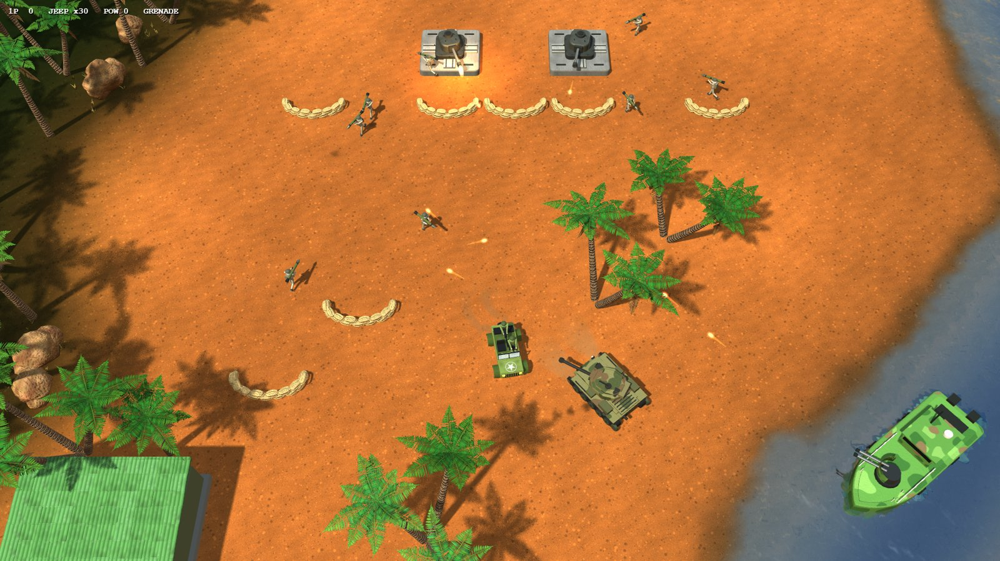
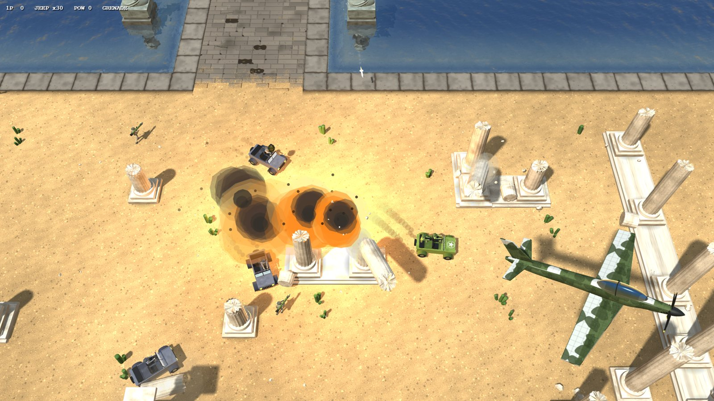
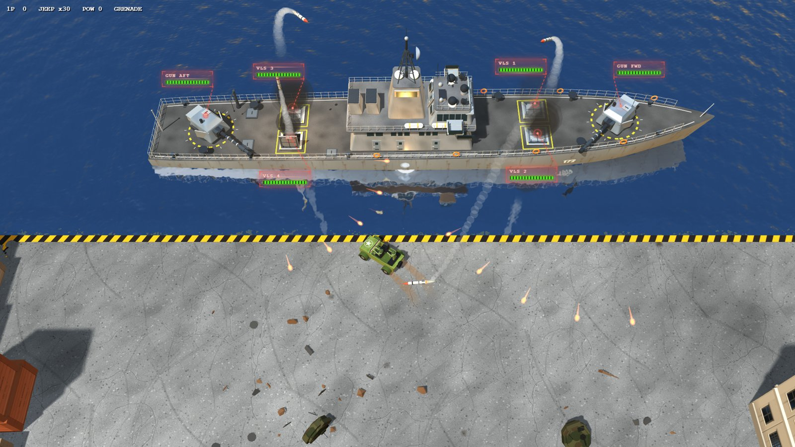
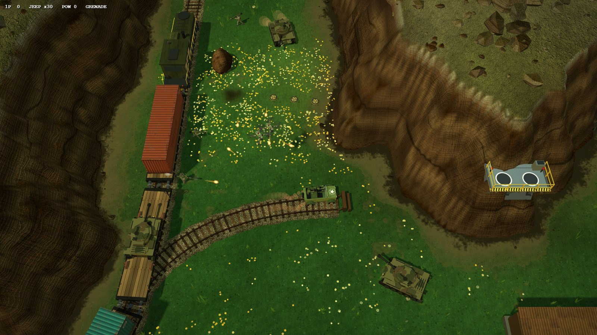
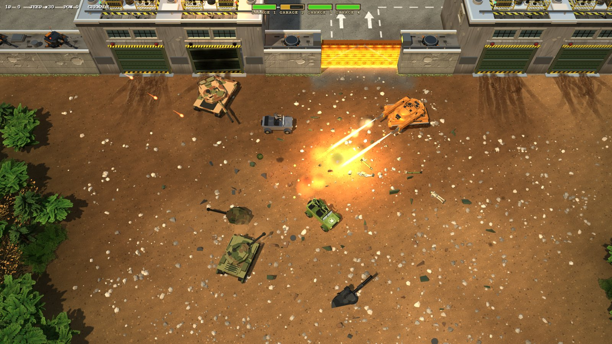
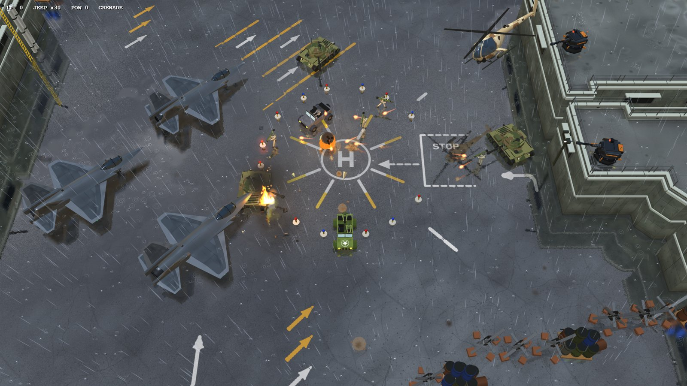
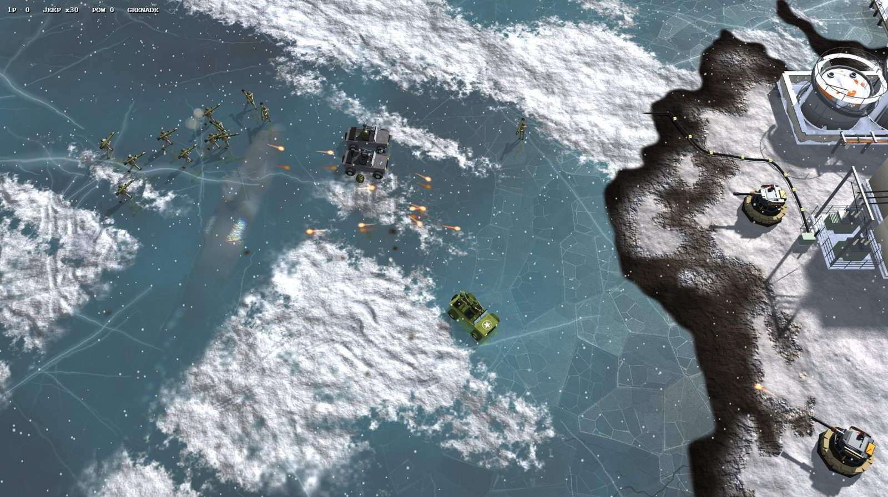

<div align="center">

# Jackal Remaster

**NES *Jackal* (1988) rebuilt as a 3D game that runs in your browser.**

[▶ **Play it now**](https://phu004.github.io/jackal-remaster/) · [🎬 **Watch the showcase video**](https://www.youtube.com/watch?v=It7ujn2-rEY)


</div>

## What is this?

A single-player 3D remaster of Konami's classic run-and-gun, *Jackal* (*Tokushu Butai Jackal*). Drive the jeep through six stages and a hidden snow level, rescue prisoners, and take down new bosses. It is built with three.js (r128) and Vite, and needs no download or install.

## Features

- **6 stages rebuilt in 3D**, including the stage 1 map generated from the original NES layout
- **A secret snow level**, reached through a hidden exit on stage 5
- **New boss fights**, including twin walkers and a final super tank
- **Procedural assets**: the models and effects are generated in code

## Screenshots

| Stage 1 | Stage 2 | Stage 3: naval base |
|---|---|---|
|  |  |  |

| Stage 4 | Stage 5 | Stage 6 |
|---|---|---|
|  |  |  |

| Secret snow level |
|---|
|  |

## Controls

| Key | Action |
|---|---|
| WASD / arrows | Move |
| J / Z | Machine gun |
| K / X | Grenade (fires the way you face) |
| Enter | Skip the intro |
| P | Performance overlay |

## Run it locally

```
npm install
npm run dev
```

Then open the URL it prints. More notes on the levels, assets and debug options are in [docs/DEVELOPMENT.md](docs/DEVELOPMENT.md).

## Built with

- [three.js](https://threejs.org/) r128
- [Vite](https://vitejs.dev/)
- Assets designed with Claude

## Credits and legal

*Jackal* is a trademark of Konami. This is an unofficial, non-commercial fan project and is not affiliated with or endorsed by Konami. The original game's art, music and levels belong to their respective owners.
